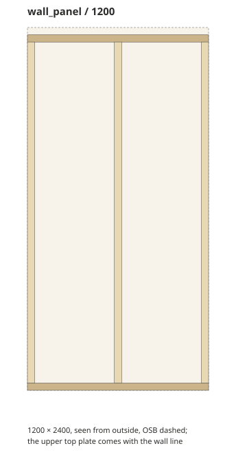
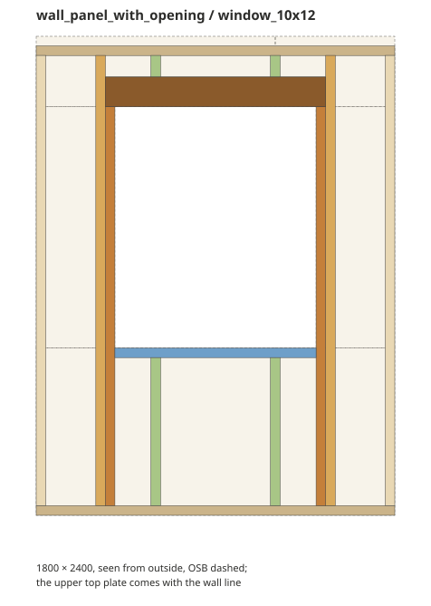
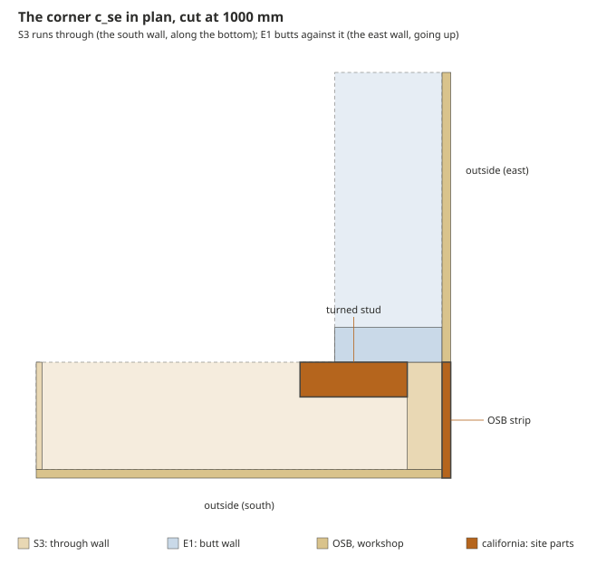
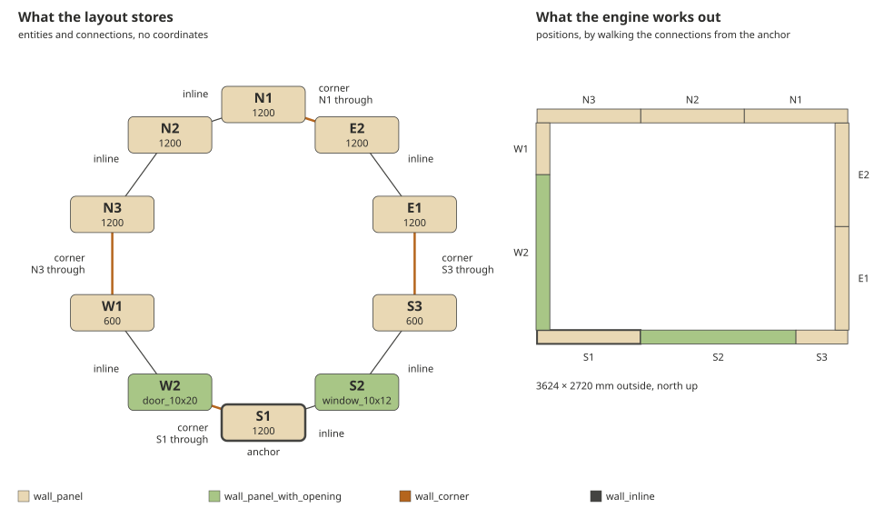
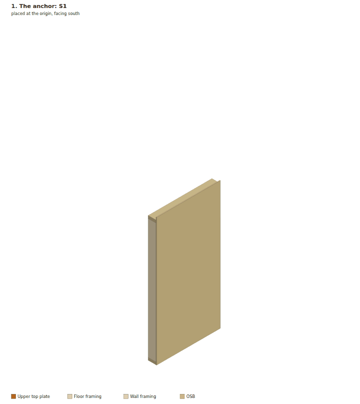
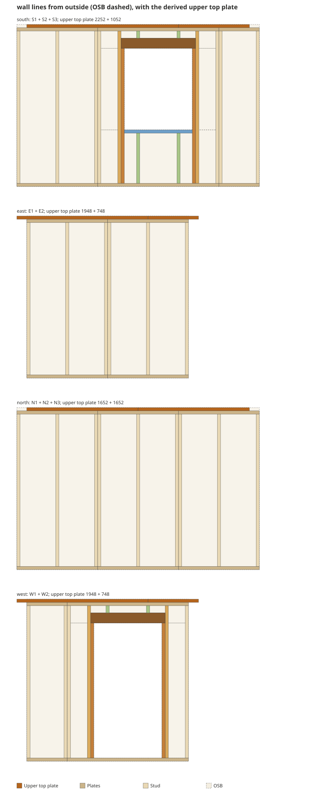
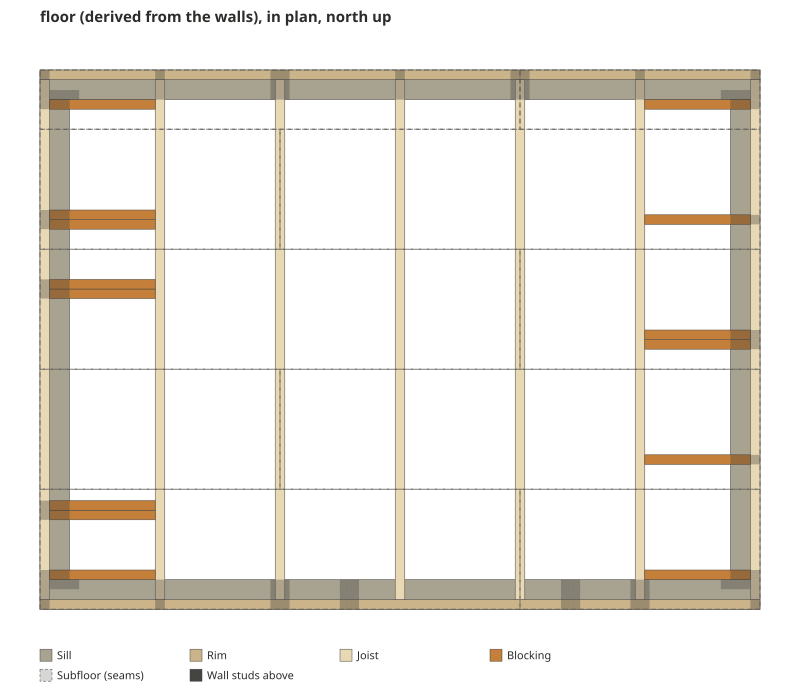
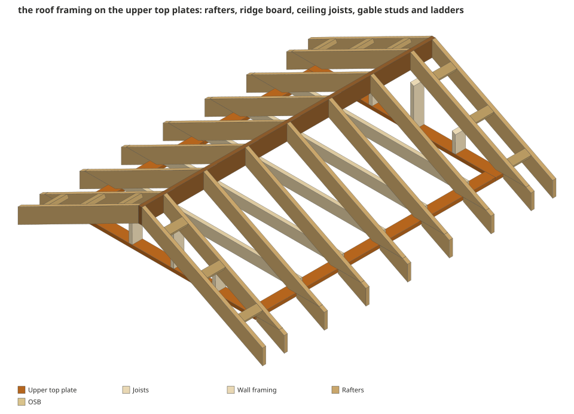
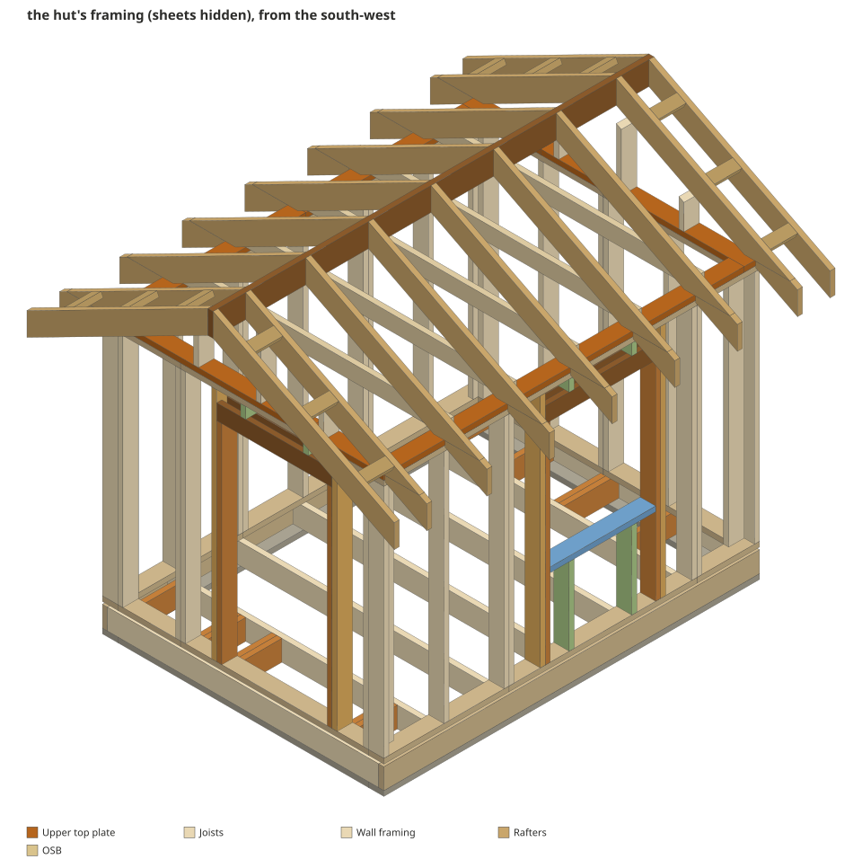

# Iconic CAD: how the design fits together

A short tour of a proposed architecture for Iconic CAD, written as lessons:
each one adds one idea, with a small hut (one room, about 3.6 x 2.7 m) as the
running example. The vocabulary at the end collects every term.

Status: prototyped and tested on a fork (walls, a wall with a window or door,
corners, the upper top plate, a floor and the roof framing). Marked *planned* where it isn't
built yet.

## The big picture

Iconic CAD works in three phases:

- **Library time**: what *can* be built. Contributors write the library; it is
  checked and compiled ahead of time.
- **Design time**: what *you* build. You pick building blocks from the library
  and say how they connect; the tool works out the rest.
- **Build time**: building it. The workshop and the site work from what the
  design produced: fabrication cards per panel, cut lists, the bill of
  materials and a build book in build order (*planned* for the new model).

```
 LIBRARY TIME                 DESIGN TIME                         BUILD TIME

 modules, systems,            layout: what you                    fabrication cards,
 interfaces                   placed and how it                   cut lists, bill of
 (YAML + JS code)             connects                            materials, build book
       │                            │                                    ▲
       ▼                            ▼                                    │
 library builder ──► library ──► engine ──► model: every part, ──────────┘
                     asset                  joint and issue
                     (one JSON file         (also drives the 3D view)
                     the app loads)
```

The app is fully static (no server): catalog modules are compiled when the
library is built, and the browser does the rest.

## Lesson 1: a module is a parametric building block

A **module** is a kind of building block, such as *wall panel* or *wall panel with
opening*. It has **parameters** (width, height, stud spacing, lumber, build-up)
and code that turns parameter values into **parts**: each stud, plate, header
and sheet, with its size, material and position. That code is the module's
**compiler** (`compile.js`).

```
 wall_panel(width 1200, height 2400, spacing 600, stud 48x148)
   ──►  bottom plate, lower top plate, 3 studs, 1 OSB sheet
```




*Two compiled variants, seen from outside, coloured by role: studs, plates,
and for the window the kings, jacks, header, sill and cripples. The OSB is
dashed.*

A module knows nothing about where it will stand, or about any country's
lumber sizes. That comes next.

## Lesson 2: a system is a kit

A **system** is a kit of compatible parts and rules for one way of building:
its lumber and sheet catalog, its build-ups (the layers of a wall), its
fastening schedule, and its grid. Examples: *SEH* (Seed Eco-Home, US sizes) and
*seh_no* (SEH adapted to Norway: metric, studs at 600 mm).

A module and a system meet in a **variant**: a named, fixed set of parameter
values for that module in that system.

```
                                 system: seh_no (48x148, OSB 12, c/c 600, ...)
 module: wall_panel              ──►   variants "1200", "600" (width), height 2400
 module: wall_panel_with_opening ──►   variants "window_10x12", "door_10x20"
```

Users place variants, not raw parameters, so every placed block is a
standard, checked panel, and identical panels can be built in a batch.
A module is in a system if the system has variants for it; that list is the
system's palette in the app.

A **build-up** belongs to the system, e.g. *exterior wall*: OSB on the outside
(fitted in the workshop), then wind barrier, battens and cladding (fitted on
site). Each layer says whether it is part of the panel or added on site.

## Lesson 3: ports and interfaces say how blocks connect

Each module has **ports**: named connection points, such as a wall's `left`
and `right` ends. An **interface** is an agreement between two **roles**
about how two ports meet. The wall corner has two roles: *through* (the wall
that runs to the outer corner) and *butt* (the wall that stops against it).

A port fills a role if its module says it can, and two ports connect if
they fill the two roles of one interface.

The interface does two jobs:

1. **Places** the modules: a fixed rule (here: turn 90 degrees, offset by the
   wall's framing depth).
2. Says what each role must offer, e.g. the through wall must expose its end
   stud and outer sheet.

*How* the corner is actually built is an **implementation** of the interface
(the trade calls it a construction detail). For seh_no the corner's
implementation is the *California corner*: a turned stud in the through wall
gives both linings something to nail to. Implementations add parts (the turned
stud, a strip of OSB) and choose nothing about position, so switching to
another corner detail never moves a wall.



*The hut's south-east corner, cut at 1000 mm. S3 runs through and E1 butts
against it; the wall_corner interface placed them. The orange parts come from
the implementation and are fitted on site.*

## Lesson 4: a design is a list of choices, not coordinates

A **layout** stores what you decided: the placed blocks (**entities**), how
they connect (**connections**) and one **anchor** that pins the first block
in place. No coordinates.

```json
"entities": [
  {"id": "S1", "module": "wall_panel", "variant": "1200"},
  {"id": "S2", "module": "wall_panel_with_opening", "variant": "window_10x12"},
  {"id": "S3", "module": "wall_panel", "variant": "600"},
  {"id": "E1", "module": "wall_panel", "variant": "1200"}
],
"connections": [
  {"id": "c_s12", "interface": "wall_inline", "a": "S1.right", "b": "S2.left"},
  {"id": "c_s23", "interface": "wall_inline", "a": "S2.right", "b": "S3.left"},
  {"id": "c_se",  "interface": "wall_corner", "through": "S3.right", "butt": "E1.left"}
]
```

The hut is ten panels joined by four corners: the window in the south wall
(1200 + window + 600), the door in the west wall (600 + door), and plain 1200
panels to the north and east. Each wall keeps a solid stretch at least 600
wide for bracing.



*Left: all the layout stores. Right: the positions the engine derives from
it (Lesson 5).*

Because the layout keeps the topology rather than positions, it survives
changes in size, and could be converted to another system (*planned*).

## Lesson 5: the engine turns a layout into a model

The **engine** walks the connections from the anchor, placing each entity
with the interface's rule, and assembles the finished parts into the
**model**: every entity's position, every part, every joint, and every
**issue** (a problem found by a check, such as walls that don't close into a
loop). It always produces a model, so a half-finished design can still be
shown with its problems marked.

Everything downstream (3D view, bill of materials, build book) reads the
model; nothing recomputes framing on its own.



*The engine building the hut's model: the anchor, then each panel as the walk
reaches it through a connection (the corner parts come once both walls are
in), then the derived upper top plate, floor and roof (Lesson 6).*

## Lesson 6: derived modules fill in what follows from the whole design

Some things can't belong to a single panel because they depend on the
neighbours:

- the **upper top plate**, which laps the corners and bridges the joints
  between panels;
- the **floor**, whose size and joists follow the walls standing on it;
- the **roof**, whose rafters sit on the walls' top plates;
- later the **foundation**.

These come from **derived modules**. You don't place them: the layout lists
the ones the design uses, with their parameters, and the engine runs them in
order once the walls close:

```json
"derive": [
  {"module": "storey"},
  {"module": "roof", "after": ["storey"], "parameters": {"pitch": 27, "ridge": "east_west", "eaves": 400, "gables": 300}}
]
```

```
 storey  (the walls on one level)
   ├── wall_line  × 4   one per straight run of panels: the upper top plate,
   │                    in pieces of at most 2400, joints 600 from panel joints
   └── floor            outline = the walls' framing; sill, rims, joists c/c 600,
                        blocking under the gable walls' studs, chipboard on top
 roof   (after the storey)
                        rafters c/c 600 in birdsmouths on the top plates, a
                        ridge board, ceiling joists that tie the rafters' feet,
                        gable studs, a ladder at each gable for the overhang
```

Each module sees the model so far, plus a summary from the modules it comes
after: the storey tells the roof where its plates are and which walls face
which way. If the roof fails, the walls and the floor stay in the model,
with the problem reported. A derived module's parameters come from two
places, like a catalog module's: the system fixes some (the lumber, the
spacing), and the layout gives the rest (the pitch, which way the ridge runs,
the overhang).

The ordinary modules are called **catalog modules**: they are compiled ahead
of time and placed by the user. A derived module's code (`derive.js`) gets
the design so far as input, such as the placed walls, so it runs in the
browser each time the design changes rather than ahead of time.

Parts don't have to be square to the building: a rafter is a box in its own
tilted frame, with plane cuts (at the ridge and the tail) and a notch where
it sits on the plate (the birdsmouth).



*The four wall lines from outside. The upper top plate (dark orange) laps the
corners, and its joints stay 600 mm from the joints between panels.*



*The floor in plan, derived from the walls: a sill all round, rims, joists at
600, and blocking (orange) under the studs of the gable walls (grey).*



*The roof at 27°: rafters in birdsmouths on the upper top plates, the ridge
board, a ceiling joist beside each rafter between the gables, gable studs
under the end rafters, and at each gable a ladder (a fly rafter and
lookouts) for the 300 mm overhang.*



*The hut's framing, with the sheets hidden.*

## Lesson 7: parts are held together by joints

Inside a module, and where modules meet, two parts held together form a
**joint**, of a named **joint type** such as `stud_to_plate` or
`sheathing_to_framing`. The joint type says *what* is joined; the system's
**fastening schedule** says *how*: which nail or screw, and how many or how
far apart.

```
 joint type  stud_to_plate
 seh_no      2 nails 2.8x95, toe-nailed from the stud
```

So the same design gets nails in one system and screws in another, and
fastener counts come out of the model instead of being typed in by hand.

Joints mirror interfaces one level down:

| | Between modules | Between parts |
|---|---|---|
| The contract | interface (`wall_corner`) | joint type (`stud_to_plate`) |
| How, per system | implementation (`california`) | fastening schedule entry |
| One occurrence | connection (chosen by the user) | joint (computed) |

## Lesson 8: library time, design time, build time

| | Library time | Design time | Build time |
|---|---|---|---|
| Who | contributors and CI | the person designing | the builders, in the workshop and on site |
| Runs | the library builder (Node) | the editor and the engine (browser) | nothing new: they read the outputs |
| Does | checks the library, compiles every variant, applies placement rules and builds every corner pair in advance | places entities, runs derived modules, checks the design | fabricates panels (identical variants in a batch), then erects them and fits the site parts in build order |
| Output | the **library asset** (one JSON file) | the **model**, and the outputs read from it | the building |

Library code (module compilers, implementations, derived modules) is plain
JavaScript, so the same code runs in Node at library time and in the browser
at design time, with no server.

## Lesson 9: code profiles check the design (*planned*)

A **code profile** is a building code with its edition, such as Eurocode 5
(EN 1995-1-1) with a national annex, or IRC 2021. It is chosen separately from the system, because
one system can be used under several codes. It supplies loads and checks
(spans, bracing, snow load) against the project's **site values** (snow load,
wind, climate). The rule: *the system supplies, the code checks*.

## The library on disk

```
library/
  modules/wall_panel/
    schema.yaml            parameters and ports, independent of any system
    compile.js             turns parameters into parts (derive.js for a derived module)
    systems/seh_no.yaml    this module's variants in seh_no
  interfaces/wall_corner/
    interface.yaml         roles, placement rule, checks
    implementations/california.js
    systems/seh_no.yaml    which implementation seh_no uses
  systems/seh_no/
    system.yaml            catalog, build-ups, fastening schedule
```

Adding a module to a system, or a whole new system, only adds files; a
contributor's change is typically one folder and one pull request.

## Vocabulary

| Term | Meaning | Example |
|---|---|---|
| **Module** | A parametric building block, independent of any system: its parameters, code and ports. Two kinds: catalog and derived | `wall_panel`, `wall_panel_with_opening` |
| **Catalog module** | A module compiled ahead of time and placed by the user | `wall_panel` |
| **Compiler** | A catalog module's code: parameter values in, parts out | `compile.js` |
| **Derived module** | A module compiled at design time from what the user placed, by its `derive.js` | `storey`, `wall_line`, `floor` |
| **System** | A kit for one way of building: catalog, build-ups, fastening schedule, grid, and the variants and implementations it offers | `seh_no` |
| **Variant** | A named, fixed set of parameter values for one module in one system | wall `"1200"` |
| **Build-up** | The ordered layers of a wall or floor, each fitted in the workshop or on site | `exterior` |
| **Port** | A named connection point on a module, with a position and direction | a wall's `left` end |
| **Interface** | An agreement between two roles: how they are placed, what each must offer | `wall_corner` |
| **Role** | One side of an interface | *through*, *butt* |
| **Implementation** | One way to build an interface in a system; adds parts and joints (a construction detail) | `california` corner |
| **Layout** | A design as stored: entities, connections, anchor | the hut's ten panels |
| **Entity** | A placed variant | `W2`: the door panel |
| **Connection** | One use of an interface between two entities' ports | `S3.right` through, `E1.left` butt |
| **Anchor** | The entity whose position and facing are fixed; the rest follow | `S1` at the origin |
| **Engine** | Turns a layout and the library asset into a model | |
| **Model** | Everything that follows from a layout: positions, parts, joints, issues | |
| **Part** | One physical piece | a stud, a header, a sheet |
| **Joint** | Two parts held together | a stud on the bottom plate |
| **Joint type** | What is joined, independent of system | `stud_to_plate` |
| **Fastening schedule** | The system's table of how each joint type is fastened | 2 nails 2.8x95 |
| **Issue** | A problem found by a check, with a reason | the walls don't close |
| **Storey** | The walls on one level and what follows from them (derived) | |
| **Wall line** | The panels in a straight run between corners, with the upper top plate (derived) | the north wall |
| **Code profile** | A building code and edition that checks the design (*planned*) | Eurocode 5 |
| **Library time / design time** | When the library is built / when a design is edited | |
| **Library asset** | The compiled library, one JSON file the app loads | `library.json` |

## Toolchain

The toolchain is a few **components**, each a separately runnable program,
connected by **artifacts** (files). Each component works in **passes**, steps
that hand their result to the next in memory. A component can be replaced
without touching the others as long as it reads and writes the same
artifacts.

```
 library source ──► library builder ──► library asset ──┐
                                                         ├──► engine ──► model ──► consumers ──► outputs
                         layout (from the editor) ───────┘
```

| Component | Reads | Writes | Passes |
|---|---|---|---|
| **Library builder** (`scripts/build_library.mjs`, Node) | library source | library asset | load, validate, resolve parameters against the system, compile variants, place and build implementations for every port pair, export |
| **Editor** (the app's UI, browser) | library asset | layout | |
| **Engine** (browser, or Node for tests and the command line) | layout, library asset | model | load, check, place, close loops, assemble, run derived modules, summarise |
| **Consumers** (3D view, plan, bill of materials, build book, FreeCAD export) | model | outputs | |

| Artifact | What it is | Example |
|---|---|---|
| **Library source** | The library as contributors write it: YAML for schemas, systems and interfaces; JavaScript for module code and implementations | `library/` |
| **Library asset** | The compiled library: every variant's parts, every port pair's placement and implementation, derived modules' parameters | `web/assets/library.json` |
| **Layout** | A design: entities, connections, anchor, which derived module to run | `hut.json` |
| **Model** | Positions, parts, joints and issues | `hut.model.json` |
| **Outputs** | What people use | SVG drawings, CSV lists, `.FCStd`, PDF build book |

Generated artifacts are only changed by regenerating them. The editor reads
only the library asset, which keeps the app
independent of how the library is written.

Checks split by phase: anything about one module, variant or interface runs
in the library builder (parameter ranges, catalog references, whether two
variants can meet); anything about a whole design runs in the engine (loops
close, no port used twice, and later the code profile's checks).
